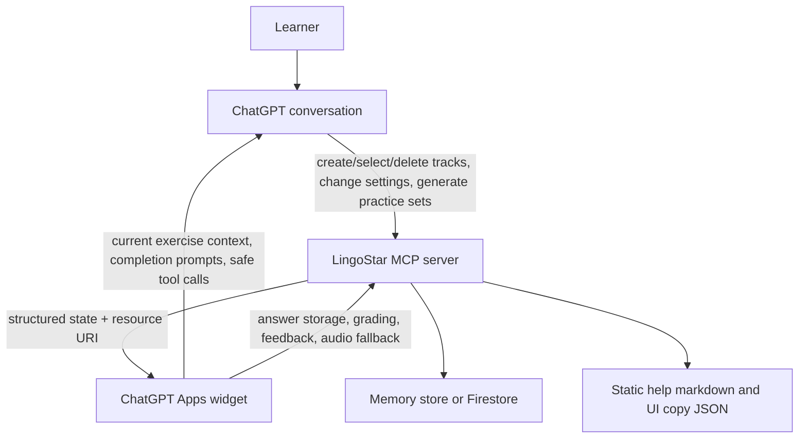

# LingoStar Architecture

LingoStar is an interactive-decoupled ChatGPT App. ChatGPT plans, explains, generates exercises, and grades speaking. The MCP server owns state, validation, user isolation, resource registration, and compact widget rendering.

## Runtime Flow

## Responsibility Split

| Layer | Responsibility |
| --- | --- |
| ChatGPT | Understand natural language, present progress tables, manage settings conversationally, generate practice sets, answer questions, grade speaking, judge levels and goals |
| MCP server | Tool schemas, auth/resource-server behavior, per-user state persistence, CRUD validation, widget resources, translated UI copy, static help, feedback storage |
| Widget | Welcome onboarding, learning-track selection, exercise solving, objective grading, current exercise context sync, centered audio/speech notices, feedback |
| Store | Durable state keyed by the current authenticated Apps user or local developer fallback |

The widget intentionally does not implement a dashboard or settings page. Progress, settings, and deletion are conversation-first because ChatGPT already provides the native composer and Markdown surface.

Host synchronization is deduplicated. The widget must not call `setWidgetState`, `requestDisplayMode`, intrinsic height notifications, or model-context updates on every render. Those calls are reserved for meaningful state changes so ChatGPT does not repeatedly remount or dim the widget while the learner is trying to click.

## ChatGPT UI Resources

| Resource | Default view | Primary use |
| --- | --- | --- |
| `ui://widget/lingostar-welcome-v0-10-2.html` | `welcome` | First-start onboarding and user-facing feature overview |
| `ui://widget/lingostar-session-select-v0-10-2.html` | `select` | Choose or delete an existing learning track |
| `ui://widget/lingostar-lesson-v0-10-2.html` | `lesson` | Solve the active practice set |

The server also keeps the previous `v0-10-1` widget resource URIs registered as compatibility aliases. This prevents already-open ChatGPT conversations or cached published-app metadata from failing with a template-fetch error after a version bump.

Data-only tools handle state reads, static help search, settings updates, deletion, grading, audio fallback, and feedback. Render tools only choose the appropriate component template.

## Learner Terms

The code still uses `session` and `section` internally, but user-facing copy prefers:

| Internal term | User-facing term |
| --- | --- |
| Language session | Learning track |
| Section | Practice set |
| Exercise | Exercise or problem |

Tool descriptions and schemas mention both terms where useful so the model can map Korean or English user phrasing to the correct structured input.

## Section Model

Each practice set contains configured counts for these areas:

| Area | Count |
| --- | --- |
| `language_info` | 3-6 |
| `listening` | 3-6 |
| `reading` | 3-6 |
| `writing` | 3-6 |
| `speaking` | 3-6 only when speaking is enabled |

`language_info` is required for completion but is not part of the weighted pass score. Server validation rejects missing payload fields, wrong counts, or unknown exercise types.

## Settings

Settings are changed by natural language through `update_lingostar_settings`; no settings widget is registered.

Supported settings include:

- display language
- target/native language for a track
- goal, progress context, weakness context, interests, and avoid topics
- per-area exercise counts
- pass threshold
- minimum completed practice sets before goal completion
- listening speed
- speaking on/off

Changes are stored on the selected learning track and used when the next practice set is generated. The current practice set is not rewritten mid-stream.

## Grading And Completion

The widget immediately grades objective exercises:

- `language_info`
- `listening`
- `reading`
- `writing`

Speaking answers are submitted to ChatGPT with already-saved objective results clearly separated, so the model grades only speaking and does not mark solved items as skipped.

When the practice set is complete, the widget requests inline display mode. The next action is conversational: ChatGPT can summarize results, show track status as a table, or create the next practice set.

## Persistence And User Isolation

Every MCP tool derives the user key from the Apps request context before reading or mutating state. A user can only list, select, update, or delete learning tracks stored under that derived key.

Resolution order:

1. OAuth or ChatGPT subject metadata
2. ChatGPT user headers
3. Conversation/session metadata
4. Local anonymous fallback

`--developer-mode` intentionally maps all requests to one local demo user for recording and manual testing.

The browser REST state APIs are disabled. `/api/state` and `/api/session*` return `410`, so learning-track CRUD goes through Apps SDK tools rather than an unauthenticated web dashboard.

## Static Resources

The server loads these resources at startup:

- `content/help/en.md`
- `content/help/ko.md`
- `content/ui_en_ux.json`
- `content/ui_ko_ux.json`

The Markdown help powers `/help`, `/api/help`, `search_lingostar_help`, and the compact `gui.help` payload. The UI JSON powers widget text without baking interface copy into the component frame.
