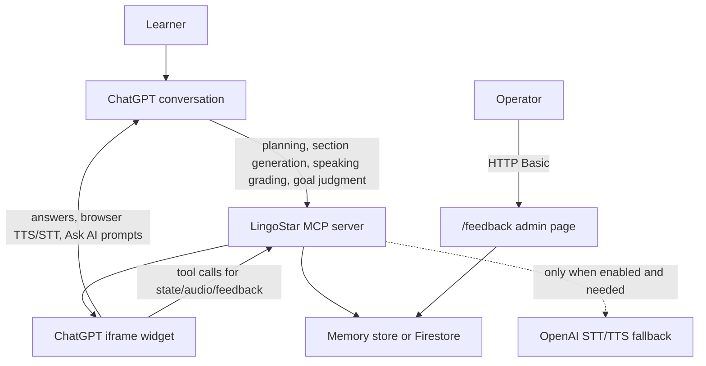

# LingoStar Architecture

LingoStar is a ChatGPT App for structured language learning. ChatGPT is the intelligence layer; the MCP server is the state, validation, widget, auth, and audio-fallback layer.

## Runtime Flow

## Responsibility Split

| Layer | Responsibility |
| --- | --- |
| ChatGPT | Interpret user goals, create sessions, generate exercises, grade speaking, judge levels/goals, provide Ask AI answers |
| MCP server | Tool schemas, structural validation, state persistence, user isolation, OAuth resource-server behavior, widget resource/versioning, translated help payloads, feedback storage, optional audio fallback |
| Widget | OOBE, first-use help, dashboard, settings, exercise UI, browser TTS/STT first, immediate objective grading, skip buttons, Ask AI entry, feedback button |
| Firestore | Durable per-user state for Cloud Run deployment |

The MCP server does not generate lessons by itself. It accepts sections generated by ChatGPT through `create_lesson_exercises`, validates them, and stores them.

## Section Model

Each section contains configured counts for five exercise areas:

| Area | Count |
| --- | --- |
| `language_info` | 3-6 |
| `listening` | 3-6 |
| `reading` | 3-6 |
| `writing` | 3-6 |
| `speaking` | 3-6 when enabled |

For foundation-stage learners, `language_info` should teach writing systems, pronunciation, symbols, particles/articles, tones, or other target-language facts before ordinary problem solving.

Server validation rejects sections that do not match the configured per-area counts or required payload fields.

## Learner Stage

The app stores one of:

- `foundation`: absolute beginner; needs symbols/pronunciation/language facts
- `intro`: can start simple controlled exercises
- `intermediate`: can handle real short passages and goal-oriented practice
- `advanced`: can handle nuanced, exam, professional, or free conversation tasks

The stage is inferred from user context, goal, levels, progress context, and weakness context, and it can be updated through the session settings/state.

## Grading

The widget immediately grades objective areas:

- `language_info`
- `listening`
- `reading`
- `writing`

Speaking is left for ChatGPT at section submission. The implementation intentionally keeps this flexible so speaking can later move to immediate grading.

Section pass/fail uses:

- listening: 0.2
- reading: 0.4
- writing: 0.3
- speaking: 0.1

Default threshold is 85. `language_info` completion is required but unweighted.

## Audio

Browser APIs are first:

- TTS: `speechSynthesis`
- STT: `SpeechRecognition`

Server OpenAI fallback is used only when `IS_AI_FALLBACK=true` and `OPENAI_API_KEY` is configured. If `IS_AI_FALLBACK=false`, browser speech failures show only “브라우저 내 음성 기능 오류”.

## Persistence and User Isolation

Local development can use process memory. Cloud Run must use Firestore because instances are stateless and can scale horizontally.

User keys are resolved in this order:

1. OAuth/ChatGPT subject metadata
2. ChatGPT user metadata headers
3. Conversation/session metadata
4. Local anonymous fallback

`--developer-mode` forces every request to `developer-mode:local-demo-user` for stable demo-video recording.

## Help and Feedback

The server injects `gui.help` into app state from server-owned help content. Help content is cached under `translationCache.widgetVersion`, so a widget version bump clears stale cached help for that user's state.

The widget shows help on first use and keeps a help button in the top bar. It also exposes a feedback button on every screen. Feedback is submitted through `submit_feedback`, stored in the user's state, and appended to a global feedback index. Operators can review feedback at `/feedback` with credentials from `FEEDBACK_ADMIN_ID` and `FEEDBACK_ADMIN_PASSWORD`.

## Logical Multi-Contexts

The current implementation is not a separate hosted multi-agent runtime. It persists logical agent contexts:

- User Agent: stable user namespace
- Language Selection: language sessions and goals
- Tracking Agent: progress context by session
- Problem Management Agent: weakness context by session

ChatGPT performs the orchestration and reasoning; the MCP server stores and validates the contexts.
