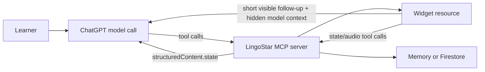

# GPT Call vs MCP Server Boundary

LingoStar deliberately separates ChatGPT reasoning from MCP server responsibilities.

## Boundary Diagram

## ChatGPT Does

- Understand natural-language learning goals.
- Decide learner stage: foundation, intro, intermediate, advanced.
- Create or update language sessions.
- Generate structured exercise sections.
- Grade speaking answers at section submission.
- Judge level and goal completion under CEFR or explicit exam standards.
- Answer Ask AI questions without replacing the active section.

## MCP Server Does

- Expose Apps SDK tools and widget resource metadata.
- Enforce structural output schemas and descriptions.
- Validate per-area exercise counts and payloads.
- Store state by user key.
- Maintain logical multi-context records in `agentContexts`.
- Provide OAuth resource-server metadata and bearer-token checks.
- Provide server STT/TTS fallback when enabled.

## Widget Does

- Render dashboard, settings, OOBE, and lesson UI.
- Keep all UI text in the interface language while showing the target language as the learning target.
- Use browser TTS/STT first.
- Auto-grade objective answers immediately.
- Provide listening/speaking skip buttons.
- Submit speaking answers to ChatGPT for evaluation.
- Provide Ask AI while preserving the active section.

## Multi-Agent Status

The current implementation is not a process-level multi-agent backend. It is ChatGPT + MCP + durable logical contexts.

The initial design's agents are represented as persisted context roles:

- User Agent -> stable user key and state namespace
- Language Selection -> sessions, languages, goals
- Tracking Agent -> natural-language progress context
- Problem Management Agent -> natural-language weakness context

This makes the app deployable as a ChatGPT App today while preserving an upgrade path to a future server-side orchestration runtime.

## Section Contract

`exerciseCounts` is authoritative:

- Speaking enabled: `language_info + listening + reading + writing + speaking`
- Speaking disabled: `language_info + listening + reading + writing`

Each enabled area must contain its configured count, 3-6 items.

The server rejects invalid sections rather than silently accepting partial problem sets.

## Audio Boundary

Browser speech APIs are preferred. OpenAI audio tools are fallback only:

- `synthesize_speech`: TTS fallback for listening
- `transcribe_audio`: STT fallback for speaking recordings

If `IS_AI_FALLBACK=false`, the widget and server do not use OpenAI audio fallback.
