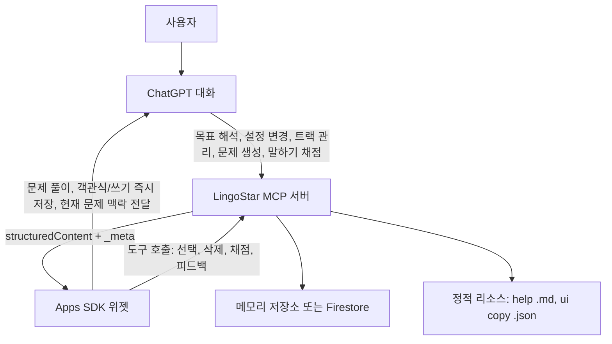
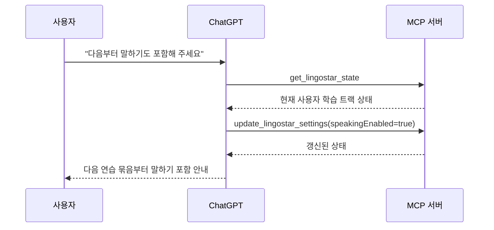
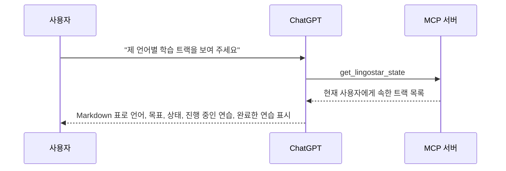
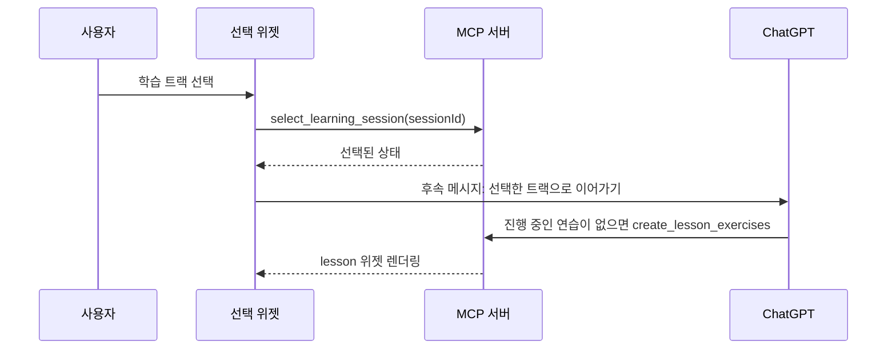
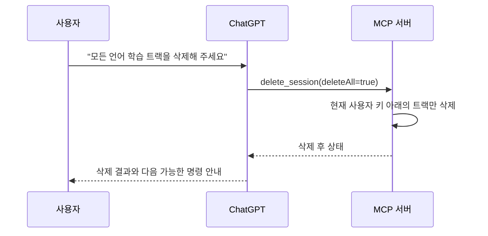
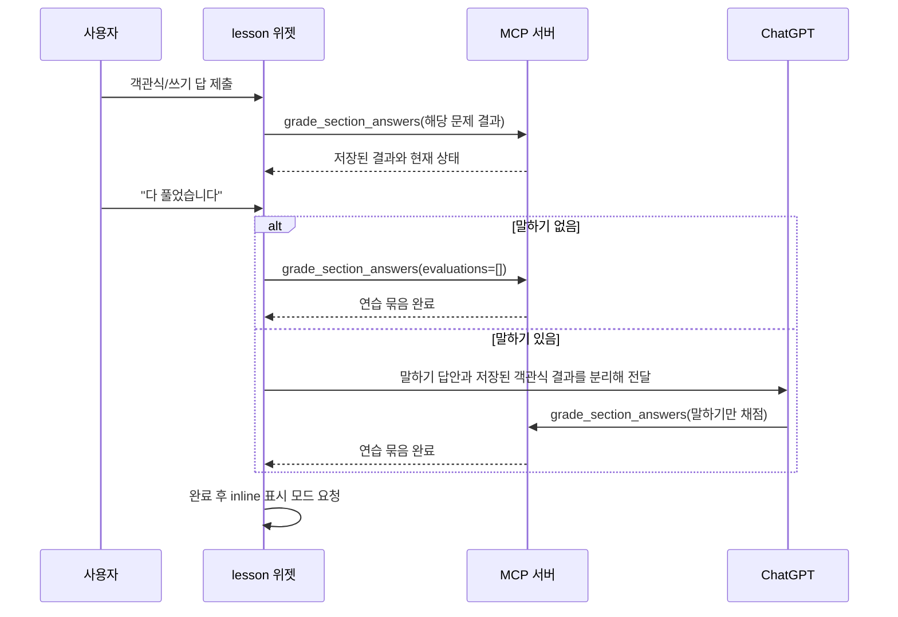

# LingoStar 구조도

이 문서는 LingoStar의 현재 설계 구조와 응답 흐름을 한글로 설명합니다. 핵심 원칙은 “ChatGPT는 대화와 판단, MCP 서버는 상태와 검증, 위젯은 문제풀이”입니다.

## 핵심 용어

| 내부 코드 용어 | 사용자에게 보이는 말 | 의미 |
| --- | --- | --- |
| session | 학습 트랙 | 하나의 목표 언어와 목표를 담은 공부 단위 |
| section | 연습 묶음 | 한 번에 푸는 문제 세트 |
| exercise | 문제 | 언어 정보, 듣기, 읽기, 쓰기, 말하기 중 하나 |

사용자에게는 가능한 한 “세션/섹션”보다 “학습 트랙/연습 묶음/문제”라고 안내합니다. 다만 서버와 도구 입력은 기존 구조와 호환되도록 `session`, `section` 필드를 유지합니다.

## 전체 구조



## 위젯 설계

위젯은 세 가지 화면만 가집니다.

| 위젯 | 역할 |
| --- | --- |
| welcome | 처음 시작 안내, 사용자 기능 소개, 설정을 대화로 바꿀 수 있음을 안내 |
| select | 저장된 학습 트랙 선택 또는 삭제 |
| lesson | 현재 연습 묶음 문제풀이 |

다음 기능은 위젯 안에 넣지 않습니다.

- 설정 화면
- 진행 상황 대시보드
- 별도 Ask AI 입력창
- 문제풀이와 무관한 깊은 내부 이동

이 기능들은 ChatGPT 대화가 이미 잘 처리하므로 도구와 Markdown 응답으로 분리합니다.

## 대화형 설정 흐름



설정 변경은 현재 열려 있는 연습 묶음을 중간에 바꾸지 않습니다. 다음 연습 묶음을 만들 때 반영합니다.

## 학습 트랙 조회 흐름



조회 결과는 항상 표로 정리합니다. 상세 피드백이나 기록은 사용자가 요청할 때만 대화로 보여 줍니다.

## 트랙 선택 흐름



선택한 트랙에 완료하지 않은 연습 묶음이 있으면 그것을 우선합니다. 없으면 ChatGPT가 다음 연습 묶음을 생성합니다.

## 삭제 흐름



삭제는 현재 사용자 저장소 안에서만 수행됩니다. 다른 사용자의 Firestore 문서나 메모리 상태는 조회하거나 수정하지 않습니다.

## 문제풀이 및 채점 흐름



말하기 제출 시 위젯은 이미 저장된 언어 정보, 듣기, 읽기, 쓰기 결과를 별도 목록으로 전달합니다. ChatGPT는 말하기만 평가해야 하며, 이미 저장된 답안을 “건너뜀”으로 간주하면 안 됩니다.

## 다국어 UI 리소스

UI 텍스트는 프레임 코드와 분리합니다.

| 파일 | 역할 |
| --- | --- |
| `content/ui_ko_ux.json` | 한국어 위젯 문구 |
| `content/ui_en_ux.json` | 영어 위젯 문구 |
| `content/help/ko.md` | 한국어 도움말 |
| `content/help/en.md` | 영어 도움말 |

서버는 시작 시 JSON과 Markdown을 읽고, 사용자 언어에 맞는 텍스트를 위젯 HTML과 상태에 주입합니다.

## 응답 하단 기본 명령

장기간 돌아온 사용자도 바로 조작할 수 있도록 일반 응답 끝에는 짧은 명령 목록을 붙입니다.

```text
---
바로 쓸 수 있는 말:
- "다음 연습 시작"
- "제 언어별 학습 트랙을 보여 주세요"
- "설정을 바꾸고 싶어요"
- "현재 문제를 설명해 주세요"
```

서버의 `replyWithState`도 기본 명령 footer를 붙여 도구 응답이 오래된 안내만 남기지 않도록 합니다.
